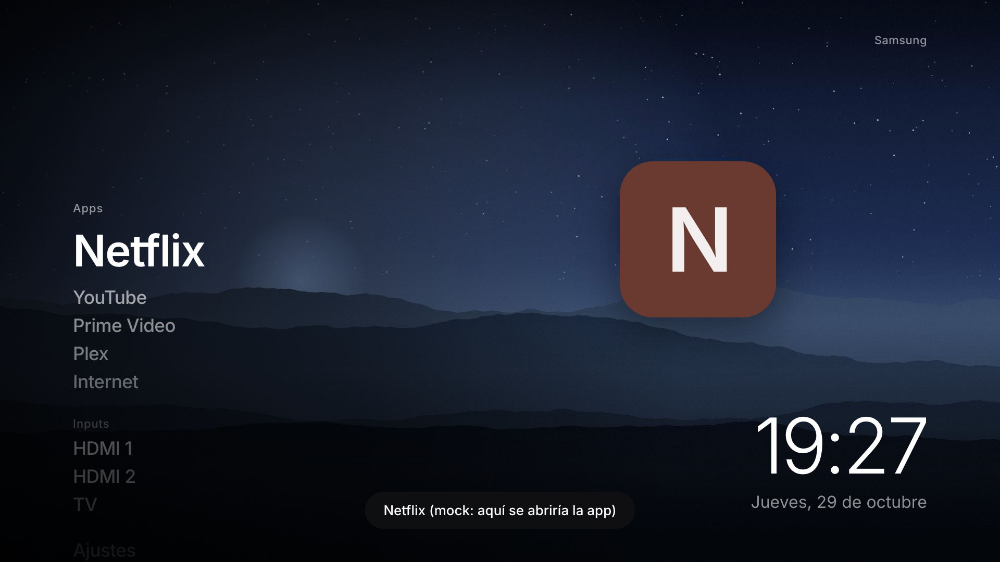
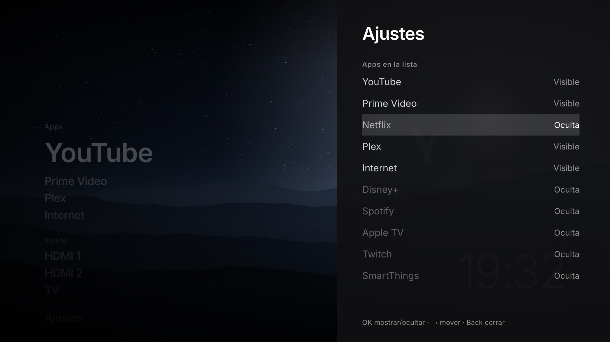

# Launcher para Samsung TV (Tizen 6.5)

Launcher minimalista para una Samsung Q80BA (2022, Tizen 6.5, Chromium M85). Incluye una lista de apps e inputs controlada con el mando, un icono grande, un reloj y fondos de paisaje con crossfade. Se instala como **módulo de TizenBrew** o como **.wgt**.




> El botón Home del mando sigue abriendo el Smart Hub. Esto es una app que se abre, no un reemplazo del sistema.

## Desarrollo en local

```bash
npm install
```

```bash
npm run dev
```

Abre `http://localhost:5173`. En el navegador se usa `src/platform/mock.js`: "lanzar app" solo muestra un toast.

| Mando | Teclado en el Mac | Acción |
|---|---|---|
| ↑ ↓ | ↑ ↓ | Mover el foco |
| OK | Enter | Abrir app / input / ajustes |
| Back | Esc o Backspace | Cerrar ajustes (en la home no hace nada) |
| Rojo | R | Ajustes |
| Verde | G | Siguiente fondo |
| Azul | B | Diagnóstico: plataforma y estado de los iconos de cada app |
| 1–9 | 1–9 | Saltar al elemento N |

Parámetros de URL para simular casos de la tele:

- `?inputs=viewer` simula TizenBrew: solo aparece "TV".
- `?inputs=none` simula que no hay visor de TV.
- `?apps=empty` simula que `getAppsInfo` falla, así que se usan los appId de fallback.
- `?mock` fuerza el mock incluso en la tele.

Comprobaciones con Playwright (capturas a 1920×1080 en `shots/`):

```bash
npm run check -- http://localhost:5173/ nav
```

```bash
npm run check -- http://localhost:5173/ settings
```

```bash
npm run build && npm run check:build
```

```bash
npm run check:tizenbrew
```

`check:build` comprueba que `dist/assets/app.js` se parsea como ES2019 y que el CSS no usa features posteriores a M85. Después abre `dist/index.html` desde `file://`, como un .wgt, con un `window.tizen` simulado para ejercitar la capa real.

### Estructura

```
src/platform/   index.js elige tizen.js (.wgt), tizenbrew.js (módulo) o mock.js (Mac)
service/        servicio Node.js del módulo de TizenBrew (único sitio con tizen.* en ese modo)
src/keys.js     keycodes del mando (Back = 10009, colores 403–406)
src/config.js   favoritos (por nombre + appId fallback), fondos, visor de TV
src/settings.js ajustes en localStorage con try/catch y validación
src/apps.js     fusiona apps instaladas + favoritos + orden guardado
src/ui/         home (lista), hero (icono), clock, background, settings-screen, toast
tizen/          config.xml e icon.png del .wgt
scripts/        generación de fondos e icono, comprobaciones, empaquetado
```

### Personalizar

- **Favoritos por defecto:** `FAVORITES` en `src/config.js`. Se buscan por nombre. El `fallbackId` sale de listas comunitarias; compruébalo en tu tele (ver *Depurar*).
- **Fondos:** sustituye los JPG de `public/backgrounds/`, mejor a 1920×1080, calidad ~80 y menos de 400 KB. Si añades o quitas alguno, actualiza `LOCAL_BACKGROUNDS`. `npm run backgrounds` regenera los paisajes incluidos.
- En la propia tele, desde Ajustes: qué apps se ven y en qué orden, 12/24 h, idioma de la fecha, fondos incluidos u online (Picsum, con fallback a los locales), rotación, modo de Inputs y texto superior.

## Instalar en la tele con TizenBrew

TizenBrew no instala nada en la tele: descarga el módulo desde GitHub a través de jsDelivr (`cdn.jsdelivr.net/gh/usuario/repo/...`). Lo sirve en `http://127.0.0.1:8081/module/...` y lo abre en su propia ventana. Por eso **`dist/` debe estar commiteado** y el `package.json` de la raíz lleva los campos del módulo:

```json
"packageType": "app",
"appName": "Launcher",
"appPath": "dist/index.html",
"keys": ["ColorF0Red", "ColorF1Green", "ColorF2Yellow", "ColorF3Blue", "0", "…", "9"]
```

TizenBrew registra esas `keys` antes de abrir el módulo.

1. **Modo desarrollador con la IP de tu Mac.** En la tele, abre *Apps* y escribe `12345` con el mando. Activa *Developer mode*, pon la IP de tu Mac en *Host PC IP* (*Ajustes del Sistema → Wi-Fi → Detalles*), acepta y **reinicia la tele** (mantén pulsado el botón de encendido hasta ver el logo).
2. **Instala TizenBrew.** Descarga *TizenBrew Installer* para macOS desde [las releases de `reisxd/TizenBrewInstaller`](https://github.com/reisxd/TizenBrewInstaller/releases/latest). Ejecútalo desde Terminal (`chmod +x tizenbrew-installer-…` si hace falta), con el Mac y la tele en la misma red, y pulsa *Install TizenBrew*. Lo de iniciar sesión con la cuenta Samsung solo se pide a partir de Tizen 7. Al terminar, TizenBrew aparece en *Apps* de la tele.
   - **Después, cambia la Host PC IP a `127.0.0.1`** (mismo menú `12345`) y reinicia. Los métodos de instalación alternativos de la documentación oficial lo piden de forma explícita: el servicio de TizenBrew se conecta él mismo al depurador de la app y para eso necesita esa IP. Si TizenBrew no abre los módulos, este es el primer sitio que hay que revisar.
3. **Publica el módulo.** Sube este repo a GitHub con `dist/` incluido:

   ```bash
   npm run build && git add dist && git commit -m "build" && git push
   ```

   Opcional: crea un tag (`git tag v0.1.0 && git push --tags`) para fijar versión.
4. **Añádelo.** Abre TizenBrew, entra en *Module Manager* → *Add GitHub Module* y escribe `tu-usuario/tizen-launcher` (o `tu-usuario/tizen-launcher@v0.1.0`).
5. **Ábrelo** desde la lista de módulos. Para que arranque directamente al abrir TizenBrew: *Settings* → *Autolaunch Settings* → *Launcher*.
6. **Actualizar.** jsDelivr cachea las ramas durante horas. Usa un tag nuevo (cambia el módulo en TizenBrew) o purga la caché abriendo `https://purge.jsdelivr.net/gh/tu-usuario/tizen-launcher@main/package.json` y lo mismo para `dist/index.html`, `dist/assets/app.js` y `dist/assets/style.css`.

**Cómo funciona dentro de TizenBrew:** la página del módulo es una web normal servida desde `http://127.0.0.1:8081` y **no tiene `window.tizen`**. TizenBrew solo da acceso a la API de Tizen a los *servicios* de los módulos, que ejecuta con Node.js. Por eso el `package.json` declara `"serviceFile": "service/service.js"`: una mini API HTTP en `127.0.0.1:8183` (`/apps`, `/launch`, `/icon`, `/model`) que la página usa con `fetch` (`src/platform/tizenbrew.js`). Además, el servicio lee los iconos reales de las apps, que son ficheros del sistema, y los sirve a la página. `npm run check:tizenbrew` reproduce todo esto en local.

**Limitaciones dentro de TizenBrew:**

- Los servicios no tienen ventana, así que no pueden usar `tv.window`: la sección Inputs es un único "TV", que abre el visor de TV en la última fuente usada.
- Si el launcher avisa de que *no responde el servicio de TizenBrew*, cierra y reabre el módulo. TizenBrew guarda en caché los servicios en marcha; si actualizas el módulo y el servicio antiguo sigue vivo, reinicia la tele.

## Instalar como .wgt con Tizen Studio

Con el .wgt la app tiene sus propios privilegios (`tizen/config.xml`). Incluye `tv.window`, así que los HDMI aparecen uno a uno.

1. Instala **Tizen Studio** con el *Package Manager*. En *Extension SDK* añade las extensiones de TV de Samsung y *Samsung Certificate Extension*. Añade la CLI al PATH: `export PATH="$HOME/tizen-studio/tools/ide/bin:$HOME/tizen-studio/tools:$PATH"`.
2. **Modo desarrollador con la IP de tu Mac** (mismo menú `12345`) y reinicia la tele. Ojo: solo admite una IP. Para volver a usar TizenBrew, deja otra vez `127.0.0.1`.
3. **Conecta la tele:** `sdb connect <IP-de-la-tele>` y comprueba el nombre con `sdb devices`.
4. **Certificado:** en *Certificate Manager*, crea un perfil **Samsung** (tipo TV) llamado `launcher`. Te pide iniciar sesión con tu cuenta Samsung y añade el DUID de la tele conectada.
5. **Empaqueta e instala:**

   ```bash
   npm run wgt
   ```

   ```bash
   tizen install -n build/Launcher.wgt -t <nombre-de-sdb-devices>
   ```

   `npm run wgt` construye `dist/`, lo copia con `config.xml` e `icon.png` a `build/wgt` y firma con el perfil `TIZEN_PROFILE` (por defecto `launcher`).

## Depurar en la tele (Remote Inspector)

Con el .wgt instalado y `sdb` conectado:

```bash
sdb shell 0 debug LnchrTV001.Launcher
```

Te devuelve un puerto (`port: NNNNN`). Redirígelo y ábrelo en Chrome:

```bash
sdb forward tcp:NNNNN tcp:NNNNN
```

En Chrome ve a `chrome://inspect` → *Configure…* → añade `localhost:NNNNN`. Tienes consola, DOM y Performance de la tele real. Tizen Studio hace lo mismo con *Run As → Tizen Web Application* en modo *Debug*.

Útil en la consola de la tele:

```js
// Ver los appId reales para corregir FAVORITES en src/config.js
tizen.application.getAppsInfo((l) => console.table(l.map((a) => ({ id: a.id, name: a.name, show: a.show }))));
// ¿Existe el visor de TV y qué fuentes hay?
tizen.systeminfo.getPropertyValue('VIDEOSOURCE', (v) => console.log(JSON.stringify(v)));
```

Con TizenBrew el depurador ya lo usa el propio TizenBrew. Lo práctico es depurar la UI en local y probar las APIs con el .wgt.

## Decisiones específicas de TV

- **Chromium M85:** build a ES2019 (`?.` y `??` se transpilan) y CSS sin `:has`, container queries, `aspect-ratio`, `inset` ni `:is` (lo comprueba `check:build`). Las fechas usan tablas propias en vez de `Intl`, por si el ICU del firmware viene recortado.
- **Script clásico IIFE, sin `type="module"`:** un .wgt se carga desde `file://` y Chromium bloquea los módulos ES con ese origen. Por el mismo motivo se quita `crossorigin` del HTML.
- **Solo `transform` y `opacity`:** la lista calcula posiciones en JS y escala texto de 84 px con `scale()`, sin animar `font-size` ni `top`. El degradado del fondo y las sombras son estáticos, y no se usa `backdrop-filter`.
- **Fondos precargados** con `img.decode()` antes del fade (2,4 s). Ya vienen a 1920×1080, así que no hay que redimensionar en la tele.
- **Reloj** reprogramado al segundo 0 de cada minuto, y resincronizado al volver de otra app (`visibilitychange`).
- **Teclas:** flechas, OK y Back no se registran (son obligatorias). Los colores y los números se registran uno a uno con `tvinputdevice.registerKey`, y sus códigos se leen con `getKey()`.
- **Inputs:** ver `PLAN.md`. `tvwindow.setSource()` (privilegio público `tv.window`) seguido de `org.tizen.tv-viewer` es un método probado por la comunidad en TVs de 2022, pero no está documentado como cambio de fuente del sistema. No hay API documentada para abrir el selector de fuentes nativo.
